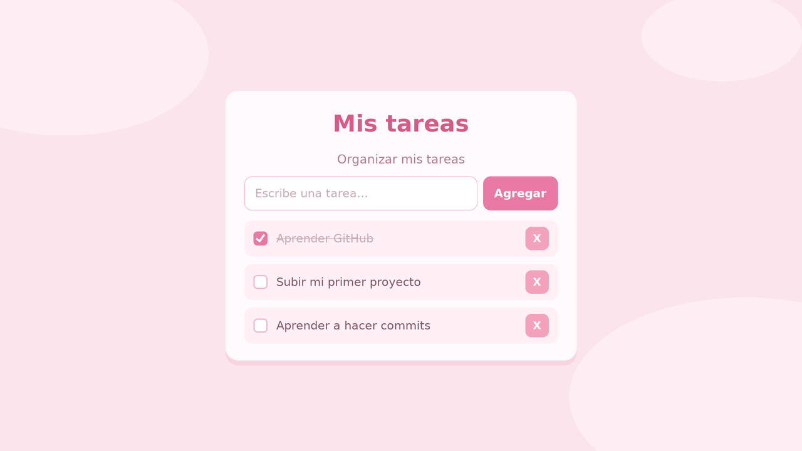

# mi_lista_de_tarea

Mis actividades

Una lista de tareas sencilla hecha con HTML, CSS y JavaScript. Las tareas se
guardan en el navegador con `localStorage`.

## Instalar en el escritorio de Windows

La app es una **PWA** (aplicación web progresiva), así que se puede instalar
como cualquier programa de Windows: se crea un acceso directo en el escritorio
y en el menú de inicio, se abre en su propia ventana y funciona sin conexión.

1. Abre la página en **Microsoft Edge** o **Google Chrome** (en `https://` o en
   `http://localhost`; las PWA no se instalan abriendo el archivo con doble clic).
2. Haz clic en el botón **«Instalar en el escritorio»** que aparece en la app,
   o en el icono de instalación de la barra de direcciones.
   Si no aparece, usa el menú **⋯ → Aplicaciones → Instalar esta aplicación
   como aplicación**.
3. Confirma en **Instalar**. Windows creará el acceso directo con el icono rosa.

> Para probarla en tu computadora, desde esta carpeta ejecuta
> `python3 -m http.server 8000` y visita `http://localhost:8000`.
> Para publicarla, GitHub Pages sirve perfecto porque usa HTTPS.

Al instalarla también tendrás un atajo en el menú contextual del icono
(**Nueva tarea**) que abre la app con el campo de texto enfocado.

## Archivos de la PWA

| Archivo | Para qué sirve |
| --- | --- |
| `manifest.json` | Manifiesto: nombre, colores, ventana, iconos y capturas que usa Windows para instalar la app. |
| `sw.js` | Service worker: guarda la app en caché para que funcione sin conexión. |
| `icons/` | Iconos en 192 y 512 px, versiones *maskable*, favicon, icono de Apple y tile de Windows. |
| `screenshots/` | Capturas que se muestran en el cuadro de instalación. |
| `browserconfig.xml` | Configuración del tile (icono) de Windows. |
| `tools/generar_imagenes.py` | Regenera todas las imágenes a partir de `icons/icon-source.png` con `python3 tools/generar_imagenes.py` (requiere Pillow). |

## Tareas

- [ ] Aprender GitHub
- [ ] Subir mi primer proyecto
- [ ] Aprender a hacer commits
- [ ] Aprender a usar Issues
